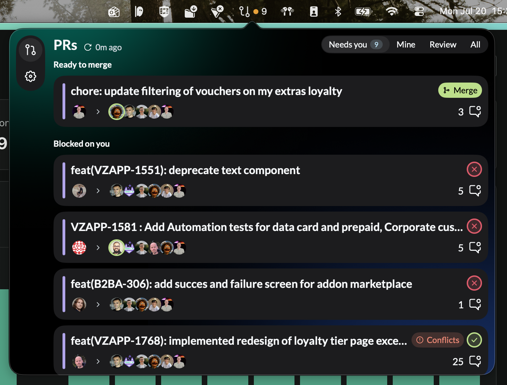
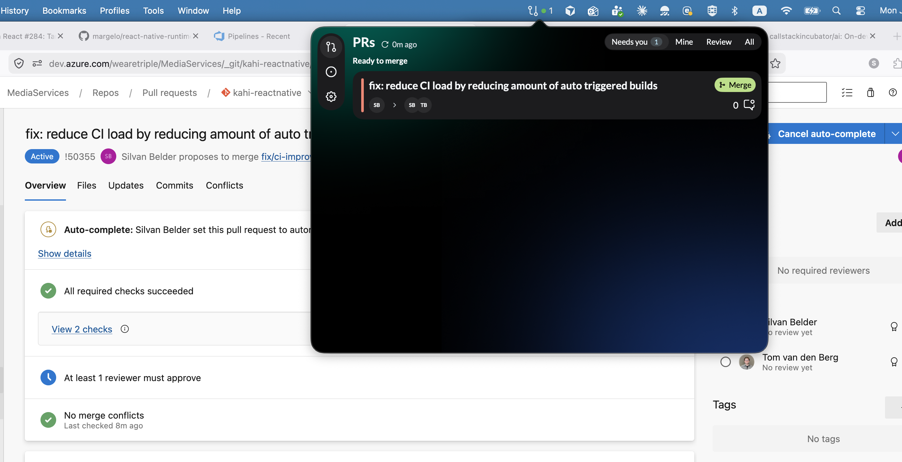
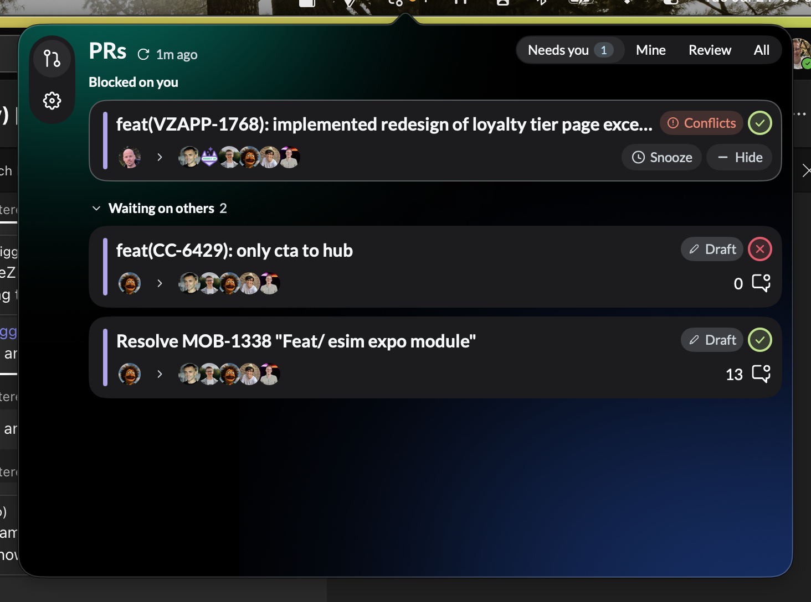

# Known issues

Running list of observed issues in GitBar. These are **documented, not fixed** —
each entry captures what was seen so it can be triaged later.

---

## KI-1 — Mergeable MR but the menu-bar status dot is orange

**Reported:** 2026-07-20
**Area:** [Menu-bar urgency dot](features/menu-bar-urgency-dot.md)
**Status:** Closed 2026-07-25 — intended behavior, no code change

### What happens

There is a pull request that is ready to merge (the green **Merge** pill shows in
the "Ready to merge" section), yet the menu-bar dot next to the PR count is
orange rather than green.



### Notes

- The dot takes the color of the *most urgent* attention bucket across all
  visible PRs, and orange (**Blocked on you**, priority 2) outranks green
  (**Ready to merge**, priority 3) per the documented urgency ramp in
  [menu-bar-urgency-dot.md](features/menu-bar-urgency-dot.md).
- In the screenshot there are four "Blocked on you" PRs alongside the single
  ready-to-merge one, so the current color follows the documented priority order.

### Resolution

Intended behavior. Someone blocked on your review is more urgent than your own
PR sitting mergeable — you can merge whenever, they cannot proceed. The dot keeps
showing the *most* urgent bucket, so orange wins.

Verified while triaging: the tint is computed from `relevantPrs`, the same
filtered/unsnoozed set as the badge count
([use-data-context-helpers.ts:76](../src/hooks/context/use-data-context-helpers.ts#L76)),
so no hidden PR can drive the color; the buckets are disjoint by construction
([get-attention-reason.ts](../src/utils/get-attention-reason.ts)); and
[get-menu-bar-tint.test.ts](../src/utils/get-menu-bar-tint.test.ts) already pins
`[readyToMerge, blockedOnYou] → orange`.

Accepted consequence: green is only reachable when *no* review is pending on you.
If "I have something to merge" ever needs its own always-visible signal, that is a
separate affordance (second dot / green ring on the count), not a reordering of
this ramp. Tint logic lives in
[get-menu-bar-tint.ts](../src/utils/get-menu-bar-tint.ts).

---

## KI-2 — Azure MR shown as "Ready to merge" but it isn't mergeable

**Reported:** 2026-07-20
**Area:** [Merge PRs](features/merge.md) · Azure DevOps provider
**Status:** Fix applied 2026-07-25 — awaiting confirmation on a real Azure PR

### What happens

An Azure DevOps PR appears in GitBar's "Ready to merge" section with the green
**Merge** pill, but the PR is not actually mergeable on Azure. In the example
(PR !50355, `MediaServices / kahi-reactnative`), Azure still reports **"At least
1 reviewer must approve"** — the PR is only set to *auto-complete* and has no
approvals yet ("No review yet" for both reviewers).



### Notes

- The merge gate requires "fully approved, **or** no approval required by the
  repository" (see [merge.md](features/merge.md) and
  [can-merge-pull-request.ts](../src/utils/can-merge-pull-request.ts)). For this
  Azure PR neither holds — an approval is still pending — yet the pill shows.
- Likely cause to investigate: how the Azure provider maps branch policies /
  required-reviewer state into the approval signal the gate reads. "Auto-complete
  is set" appears to be getting treated as "ready to merge" even though the
  minimum-approvals policy is unmet.
- Attempting the merge from GitBar would presumably be rejected by Azure (the
  minimum-approver policy is enforced server-side), so the risk is a misleading
  "Ready to merge" state rather than an unsafe merge — worth confirming during
  triage.

### Root cause

The merge gate failed **open** on missing data. `isApprovalRequired` was derived
purely from the *presence* of a minimum-approvers policy evaluation, so an empty
`policyEvaluations` array made it `false`, and the gate's "fully approved **or** no
approval required" clause was satisfied by the second half. Result: any
conflict-free Azure PR with a merge commit showed the Merge pill.

For !50355 the evaluation was definitely absent from what GitBar received — with
it present at any status, `isApprovalRequired` would be `true` and `isFullyApproved`
`false` (Azure showed "At least 1 reviewer must approve" as pending), closing the
gate. Two code paths produced the empty array: a swallowing `catch` around the
policy request, and the `#isRelevantToUser` skip that returned `policyEvaluations: []`
for un-enriched PRs. The PR was authored-by-me in GitBar's view, so the request ran
and either errored or came back empty.

### Fix

1. `api-version` added to the policy-evaluations request — it was the only
   Azure call omitting it, and the newest of the endpoints used, so a `400` there
   would have been invisible. ⚠️ The value used, `7.1`, was itself wrong and made
   *every* policy lookup `400` — see [KI-6](#ki-6--azure-pr-with-a-2-approval-policy-shows-as-mergeable-after-one-approval).
   Corrected to `7.1-preview.1` on 2026-07-28.
2. Failed lookups and un-enriched PRs now yield `policyEvaluations: undefined`
   instead of `[]`, and the failure is logged rather than swallowed silently.
3. `undefined` ⇒ `isApprovalRequired: true`. Unknown fails closed; an empty list
   still means "this repo has no branch policies". See
   [merge.md](features/merge.md#unknown-approval-state-fails-closed).

### Still to confirm

Whether the policy request was **erroring** or **returning an empty list** for
!50355 — the swallowed `catch` destroyed that evidence. Fix 1 addresses the first,
fix 3 makes either one safe, but the underlying request should be verified against
a real Azure PR that has an unmet minimum-approvers policy: the pill must not
appear, and no policy warning should be logged.

### Related

A separate suspicion surfaced while triaging: GitBar treated a PR authored by
another person as authored by the signed-in user, which is what put it in "Ready to
merge" at all. Azure is the only provider matching identity on `displayName`
instead of a stable handle (GitHub and GitLab use `profile.userName`), even though
`getProfile` already stores the account email there. Tracked as
[KI-5](#ki-5--azure-identity-matching-uses-displayname).

---

## KI-3 — Card hover state is flaky (doesn't trigger, or stays stuck active)

**Reported:** 2026-07-20
**Area:** PR list card hover actions ([Hide & snooze](features/hide-and-snooze.md))
**Status:** Fixed 2026-07-25 — verified manually; one native follow-up open

### What happens

The hover state on a PR card is unreliable: sometimes hovering a card does **not**
reveal the hover actions (Snooze / Hide), and other times the hover state **stays
active** on a card after the pointer has moved away. In the screenshot the top
card is showing its Snooze/Hide actions.



### Notes

- Intermittent / not consistently reproducible so far — needs steps to reproduce.
- Hover reveals the per-card actions (Snooze, Hide) described in
  [hide-and-snooze.md](features/hide-and-snooze.md); when the state gets stuck the
  wrong card can appear "armed".
- Things to check during triage: mouse-enter/leave handling on the card, whether
  a re-render/refresh (the list refetches — note "1m ago") drops or retains the
  hovered element, and pointer events while the popover regains focus.

### Root cause

Not the hover handlers. `onHoverIn`/`onHoverOut` bottom out in `NSTrackingArea`,
and AppKit only fires `mouseEntered:`/`mouseExited:` when the *pointer* crosses a
boundary — never when the boundary moves under a resting pointer. On a refetch that
adds, removes or reorders a PR:

- the card sliding **out** from under the pointer gets no leave → stays armed, and
  the pointer is now over a different card
- the card sliding **under** the pointer gets no enter → hover looks dead until you
  move the mouse or scroll

react-native-macos compensates for *scrolling* only, via a clip-view bounds
observer (`RCTViewComponentView.mm`, `updateClipViewBoundsObserverIfNeeded` /
`updateMouseOverIfNeeded`), and rebuilds the tracking area only when the view's own
`bounds` change. A card that merely *moves* changes neither — hence the
intermittency: it needs the list to change while the pointer rests on a card.

Ruled out: `isHoverEnabled()` is unconditionally true on macOS
(`Libraries/Pressability/HoverState.js`), so it is not the web-style touch-modality
gate; the card does not resize on the actions↔comment-count swap (`right` carries
`minHeight: 24` for exactly that reason), so there is no self-inflicted reflow;
tracking areas use `NSTrackingActiveAlways`, so window focus is irrelevant; and
popover close/reopen self-heals, because `viewDidMoveToWindow` re-runs
`updateMouseOverIfNeeded`.

### Fix

Hover moved off the card into a single `hoveredKey` on the list, cleared whenever
the rendered order changes. At most one card can be armed, so a missed leave event
can no longer strand the actions on the wrong card. The leave clear is guarded on
"is this still the armed card", since AppKit can deliver the next card's enter
first. Rows are now keyed by `accountId:id` (`getPullRequestKey`) instead of bare
`id`, closing a latent duplicate-key hazard: Azure PR ids are only unique per
organization, so two Azure accounts could collide and let React reuse a row for a
different PR. See [hide-and-snooze.md](features/hide-and-snooze.md#where-card-hover-lives).

Accepted cost: after a poll that moves cards, hover needs one pointer movement to
re-arm. Fixing that requires the native side.

### Open follow-up

`prepareForRecycle` in `RCTViewComponentView.mm` does not reset `_hasMouseOver`, so
a native view recycled from a card that was unmounted *while hovered* stays flagged
as hovered — and `mouseEntered:` early-returns on that flag, so the next card to
reuse it never fires `onHoverIn`. Snooze and Hide unmount the card you are hovering,
which makes this reachable: snooze a PR, then hover other cards.

This repo already runs `patch-package` on postinstall and ships
`patches/react-native-macos+0.81.7.patch`, so the fix is a one-line addition to that
patch's macOS block. Needs a native rebuild to take effect.

---

## KI-4 — Merging an Azure DevOps MR from GitBar does nothing

**Reported:** 2026-07-25
**Area:** [Merge PRs](features/merge.md) · Azure DevOps provider
**Status:** Open — not fixed

### What happens

Clicking the green **Merge** pill on an Azure DevOps pull request does not merge
it. The PR stays open on Azure.

### Notes

- Azure merges go through `mergePullRequest` in
  [azure-provider.ts:180](../src/core/data-providers/azure-provider.ts#L180): a
  `PATCH` to the pull-request endpoint with `status: "completed"` and
  `lastMergeSourceCommit`. GitHub/GitLab use their GraphQL merge mutations, so
  this is Azure-specific.
- Things to check during triage: whether the request is sent at all, the HTTP
  status/body Azure returns (a rejected completion may come back `200` with an
  unchanged PR rather than an error), whether `lastMergeSourceCommitId` is
  populated and current, and whether the error surfaces in the UI at all —
  `#transformApiError` may be swallowing it silently.
- Possibly the same root cause as [KI-2](#ki-2--azure-mr-shown-as-ready-to-merge-but-it-isnt-mergeable):
  if the PR isn't actually mergeable (approvals pending, auto-complete only),
  Azure would refuse the completion and GitBar would look like it did nothing.
  KI-2's fix makes the pill stop appearing on those PRs, so re-test KI-4 on a PR
  that really is mergeable before digging further.

---

## KI-5 — Azure identity matching uses `displayName`

**Reported:** 2026-07-25 (surfaced while triaging [KI-2](#ki-2--azure-mr-shown-as-ready-to-merge-but-it-isnt-mergeable))
**Area:** Azure DevOps provider
**Status:** Open — not fixed

### What happens

In the KI-2 screenshot GitBar filed PR !50355 under "Ready to merge", which only
happens for PRs you authored
([get-attention-reason.ts](../src/utils/get-attention-reason.ts)) — but Azure shows
Silvan Belder as the author, not the signed-in user.

### Notes

- `isAuthoredByMe` for Azure is `data.createdBy.displayName === profile.name`
  ([azure-pull-request.ts](../src/core/transformers/azure/azure-pull-request.ts)).
  GitHub and GitLab match on `profile.userName` (login / username), a stable handle.
  `getProfile` already puts the account email in `userName`.
- Display names are mutable and can collide; `#isRelevantToUser` uses the same
  comparison, so a mismatch also silently disables per-PR enrichment (threads,
  policies) — which is how this interacts with KI-2.
- A wrong `isAuthoredByMe` misfiles PRs into both "Ready to merge" and "Needs work",
  and the same `displayName` comparison drives `isAssignedToMe`,
  `isReviewPendingFromMe`, `isApprovedByMe` and `isCommentedByMe`.
- To check during triage: what `/_apis/profile/profiles/me` actually returns for the
  connected account (note GitBar calls it on `dev.azure.com`, while Azure documents
  profiles under `vssps`), and whether `uniqueName` on `createdBy` is the better
  field to match against.

---

## KI-6 — Azure PR with a 2-approval policy shows as mergeable after one approval

**Reported:** 2026-07-27
**Area:** [Merge PRs](features/merge.md) · Azure DevOps provider
**Status:** Fix applied 2026-07-27 — awaiting confirmation on the real Azure PR

### What happens

An Azure repo has a minimum-approvers branch policy requiring **two** approvals.
One approval is given; GitBar already shows the PR as ready to merge (green
**Merge** pill), while Azure still blocks completion until the second approval.

### Notes

- Fail-open fallback in `isFullyApproved`
  ([azure-pull-request.ts:132](../src/core/transformers/azure/azure-pull-request.ts#L132)):
  when no minimum-approvers policy evaluation is found, it falls back to
  `reviewers.some(vote === Approved | ApprovedWithSuggestions)` — **any single
  approval counts as fully approved**, regardless of the required count. Combined
  with [KI-2](#ki-2--azure-mr-shown-as-ready-to-merge-but-it-isnt-mergeable)'s
  `isApprovalRequired: true` on unknown policies, an un-enriched or failed-policy
  PR with one approval passes the gate. This is the most likely path — it needs no
  policy data at all, so the count is invisible.
- Second candidate, if policies *were* present: `find` takes the **first**
  minimum-approvers evaluation only. A repo with more than one such policy (e.g.
  differently scoped) can have the first one `Approved` while another is still
  pending, and the rest are ignored.
- Not reproducible via the policy status alone when enrichment worked: at 1-of-2 the
  evaluation status is not `Approved`, so the gate should close. So triage starts by
  confirming whether `policyEvaluations` was populated for this PR — if it was empty
  or undefined, that is candidate 1 and the fallback is the bug.
- Nothing anywhere reads `minimumApproverCount` off the policy configuration; GitBar
  only ever looks at the evaluation `status`. A count-aware check needs that field.
- Same misleading-state-not-unsafe-merge caveat as KI-2: Azure enforces the policy
  server-side, so the merge would be refused — see also
  [KI-4](#ki-4--merging-an-azure-devops-mr-from-gitbar-does-nothing).

### Root cause

Two independent bugs, both of which made the approval policy invisible.

**1. The policy request never succeeded.** Every lookup returned `400`:

```
GET …/_apis/policy/evaluations?artifactId=…&api-version=7.1 failed: 400 bad request
```

Policy *evaluations* is a preview-only endpoint — Microsoft's reference states the
version "should be set to `7.1-preview.1`", and plain `7.1` is rejected. That value
came in with KI-2's fix #1, whose whole point was that a `400` there had been
invisible; the swallowing `catch` it replaced is why nobody noticed the request had
never worked. So `policyEvaluations` was always `undefined`, and after the
fail-closed change above that hid the Merge pill on *every* Azure PR — the second
symptom reported on this issue.

**2. Wrong policy type GUID.** `AZURE_MINIMUM_APPROVERS_POLICY_TYPE_ID` held
`fa4e907d-c16b-452d-8106-7efa0cb84489`, which is Azure's *"Require a merge
strategy"* policy. The real one is `fa4e907d-c16b-4a4c-9dfa-4906e5d171dd` — the
two share their first two segments, which is how the mix-up survived review. A
live `policy/evaluations` response for one of these PRs settled it: that id comes
back with `displayName: "Minimum number of reviewers"`.

So no approval policy was ever recognised. `isApprovalRequired` came out `false`
whenever policies *were* fetched, and the merge gate passed on its
`!isApprovalRequired` half no matter how many approvals were outstanding — one, two
or zero. This is also the real cause of
[KI-2](#ki-2--azure-mr-shown-as-ready-to-merge-but-it-isnt-mergeable), which was
diagnosed as a missing-data fail-open; the data was usually there and simply never
matched.

The same response exposed a second gap: Azure returns **optional**
(`isBlocking: false`), disabled and out-of-scope (`notApplicable`) policies in the
same list. With the GUID corrected, an optional minimum-approvers policy would have
blocked the pill on a PR Azure is happy to complete.

Note the ordering: before the fail-closed change, bug 1 was *masked* by bug 2 —
`undefined` policies made `isApprovalRequired` true, and the vote fallback made
`isFullyApproved` true off a single approval, so the pill appeared anyway. That is
exactly the 1-of-2 symptom this issue was filed for.

### Fix

1. `api-version: "7.1-preview.1"` on the evaluations request, so the lookup actually
   returns data.
2. Corrected the GUID. A test now pins it against the verbatim evaluation from that
   live response, so a silent drift back fails.
3. Only **blocking, enabled, applicable** minimum-approvers evaluations gate the
   merge; a missing flag counts as blocking so unfamiliar shapes fail closed.
4. All of them must be `approved`, not just the first one `find` returned — a branch
   can carry several differently-scoped policies (candidate 2 in the notes).
5. `policyEvaluations === undefined` ⇒ `isFullyApproved: false`. Reviewer votes can
   only answer "somebody approved", never "enough people approved", so unknown fails
   closed on *both* halves of the approval clause — KI-2 had fixed only one side.
   The vote fallback survives for a *known*-empty policy list, where the value merely
   drives the "approved" badge.

`minimumApproverCount` stays unread and does not need reading: Azure reports the
evaluation `approved` once the count is met and `queued` while it is short, so the
status alone closes the gate at 1-of-2. See
[merge.md](features/merge.md#unknown-approval-state-fails-closed).

### Still to confirm

Needs a run with no `Azure policy evaluations unavailable for PR …` warnings in the
console — that warning means the lookup is still failing and *every* pill is
suppressed by design, which masks whether the approval logic itself is right. Once
the log is clean: no pill at 1-of-2, pill once the second approval lands.

### Related

The CI half of the gate has the same optional-policy blind spot: `isCiPassing`
treats any failed build/status policy evaluation as blocking, including
`isBlocking: false` ones. Not fixed here — a failing optional build is still worth
badging, so the badge and the gate would need to diverge
([azure-ci-status.ts](../src/core/transformers/azure/azure-ci-status.ts)).

---

## KI-7 — Permanent scrollbars in Settings (one user)

**Reported:** 2026-07-27
**Area:** [Settings](../src/pages/settings/settings.tsx)
**Status:** Fix applied 2026-07-28 — scroll indicators hidden app-wide, awaiting
confirmation from the reporter

### What happens

On one user's machine the Settings pane shows both a vertical **and** a horizontal
scrollbar permanently — solid tracks, always drawn, not the fading overlay
scrollbars. The horizontal one also confirms the content is wider than the popover:
the right-hand controls (the "Repository" group-by value, the toggles) are clipped
at the edge.


### Notes

- Two separate things here, worth splitting during triage:
  1. **Always-drawn, not overlay** — macOS System Settings › Appearance ›
     *Show scroll bars* set to **Always** (instead of "Automatically based on mouse
     or trackpad"). That is a system preference, not app state, which fits "one of
     my users". With `Always`, AppKit uses legacy non-overlay scrollers that take
     real layout width, so this also *causes* clipping on the right.
  2. **Horizontal overflow** — the settings rows are `flexDirection: "row"` with
     `justifyContent: "space-between"`
     ([settings.styles.ts](../src/pages/settings/settings.styles.ts)) and no
     `flexShrink`/`minWidth: 0` on the label side, so a long label plus its control
     pushes the row wider than the pane instead of wrapping or truncating. With
     overlay scrollbars this stays hidden; with legacy scrollers the lost width
     makes it visible.
- ~~The only `ScrollView` in the app is Settings~~ — wrong, and it matters: the
  reporter sees the bars on **every** scrollable page. Dashboard is a `SectionList`
  ([pull-request-list.tsx:202](../src/components/pull-request-list/pull-request-list.tsx#L202)),
  Issues a `FlatList` ([issues.tsx:80](../src/pages/issues/issues.tsx#L80)), Settings
  a `ScrollView` ([settings.tsx:133](../src/pages/settings/settings.tsx#L133)). All
  three are scroll views and none pass indicator props, so both indicators default to
  `true`. That makes the always-drawn scrollers an app-wide symptom with one cause,
  not a Settings bug — only the *clipping* was Settings-specific.
- To confirm during triage: ask the user for their *Show scroll bars* setting, then
  reproduce locally with it on `Always` and check whether the clipping matches the
  screenshot.

### Root cause

One cause, both symptoms: legacy scrollers take real layout width, overlay ones take
none. `Show scroll bars` → **Always** therefore shrank the usable width on every pane
until the right-hand controls no longer fit — which is why the horizontal bar had
something to report. Hiding the scrollers removes the stolen width, so the clipping
goes with it.

### Fix

Hidden outright on all three surfaces:

```jsx
showsVerticalScrollIndicator={false}
showsHorizontalScrollIndicator={false}
```

On macOS these map to `hasVerticalScroller` / `hasHorizontalScroller`
([RCTUIKit.m:554](../node_modules/react-native-macos/React/Base/macOS/RCTUIKit.m#L554)),
so the scroller is never created and the system preference has nothing to draw. Wheel,
trackpad and programmatic scrolling are untouched — only the visual control goes.

Accepted trade-off: nobody gets a scroll position indicator, including users with
overlay scrollbars who saw a tasteful fading one. For a menu-bar popover with three
short panes that is a fair price for a symptom the app cannot otherwise dismiss; the
alternative needed a native patch (below) and would still leave legacy scrollers
stealing layout width.

### Background — why the framework did not handle it

The system preference (*Appearance › Show scroll bars › Always*) is the trigger, but
react-native-macos already tries to defeat it. Since **0.81.7** the Fabric scroll view
forces the style in its initialiser and re-forces it when the preference changes:

```objc
// Force overlay scrollbar style to avoid layout issues with legacy scrollbars.
_scrollView.scrollerStyle = NSScrollerStyleOverlay;
```

([RCTScrollViewComponentView.mm:161](../node_modules/react-native-macos/React/Fabric/Mounting/ComponentViews/ScrollView/RCTScrollViewComponentView.mm),
plus a `NSPreferredScrollerStyleDidChangeNotification` handler that also calls
`[_scrollView tile]`.) Verified absent in 0.81.2, so this arrived with the new-arch
bump in `1871a90`. Every shipped build from v2.0.0 (67) onwards resolves `^0.81.7`.

So either the reporter is on an older release, or the forcing does not hold. Leading
hypothesis for the latter: the init path sets the style but never calls `tile`, while
the preference-change handler does. AppKit lays scrollers out per style, so a window
built while the preference is *already* `Always` would keep legacy scrollers — and it
would self-heal for anyone who toggles the preference while the app is running, which
fits "one user, permanently".

Left unproven, because hiding the scrollers makes it moot. If a scroll indicator is
ever wanted back, that is the thread to pull: reproduce with
`defaults write io.lamars.gitbar.debug AppleShowScrollBars Always` (scoped to the debug
app, not the whole system) plus `pnpm mac`, and if the hypothesis holds, add a
`[_scrollView tile]` after the init-path assignment to
`patches/react-native-macos@0.81.7.patch` — native rebuild required.

### Still to confirm

That the reporter's bars are actually gone, and that no pane lost a scroll affordance
anyone misses. Everything here is JS — no native rebuild needed, a normal release
carries it.

---

## KI-8 — Draft PR on Azure is not marked as draft in GitBar

**Reported:** 2026-07-28
**Area:** [PR list status badges](features/tabs-and-pr-list.md) · Azure DevOps provider
**Status:** Fix applied 2026-07-28 — awaiting confirmation on the real Azure draft PR

### What happens

A pull request that is a **draft** on Azure DevOps shows up in GitBar without the
draft badge, and is treated as a normal PR (it is not hidden by the "Hide draft PRs"
setting either).

### Notes

- The wiring itself looks intact: `isDraft: data.isDraft`
  ([azure-pull-request.ts:111](../src/core/transformers/azure/azure-pull-request.ts#L111))
  → `isDraft` on the model → `resolveStatusBadge` returns `"draft"`
  ([resolve-status-badge.ts:23](../src/utils/resolve-status-badge.ts#L23)). So the
  value arriving from Azure is most likely falsy/absent rather than mishandled.
- **Leading candidate: no `api-version` on the PR list request.**
  `/_apis/git/pullrequests` is fetched through `azureConfig`
  ([api-config.ts](../src/utils/api-config.ts)), which sets only the `Authorization`
  header — no `api-version` param
  ([azure-provider.ts:146](../src/core/data-providers/azure-provider.ts#L146)). Azure
  then serves a default version, and `isDraft` only exists on the newer ones, so the
  field would simply be missing from the payload. `AzurePullRequest.isDraft` is typed
  `boolean` ([pull-requests-response.ts:36](../src/core/services/api/azure/models/pull-requests-response.ts#L36)),
  so TypeScript never flags the `undefined`. Same class of invisible-version bug as
  [KI-6](#ki-6--azure-pr-with-a-2-approval-policy-shows-as-mergeable-after-one-approval)'s
  fix 1 — check the raw response first.
- **Second candidate: badge priority.** Only one badge shows, and the ramp is
  conflicts > changesRequested > draft > approved
  ([tabs-and-pr-list.md](features/tabs-and-pr-list.md)). A draft PR that also has
  conflicts or changes requested shows *that* badge instead — expected behavior, but
  worth ruling out on the reported PR before chasing the API.
- GitHub gets `isDraft` from the GraphQL fragment and GitLab maps `pr.draft`, so if
  those still badge correctly this is Azure-only.
- To check during triage: log the raw list payload for the draft PR and see whether
  `isDraft` is present at all; if absent, pin an explicit `api-version` on the request
  (and consider setting it once in `azureConfig` so no Azure call can omit it again).

### Root cause

The PR list request sent no `api-version`, so Azure served a pre-5.0 payload — and
`isDraft` does not exist on `GitPullRequest` until **5.0**. Confirmed against the
[4.1 reference](https://learn.microsoft.com/en-us/rest/api/azure/devops/git/pull-requests/get-pull-requests-by-project?view=azure-devops-rest-4.1):
the definition lists `supportsIterations`, `autoCompleteSetBy`, `mergeStatus` and the
rest, but no `isDraft`. Azure does not reject an unversioned request, it just answers
in an older shape — the
[versioning docs](https://learn.microsoft.com/en-us/azure/devops/integrate/concepts/rest-api-versioning?view=azure-devops)
give no default and simply state the version "**must** be specified with every
request".

So `data.isDraft` was `undefined`, `isDraft` on the model went falsy, and
`resolveStatusBadge` fell straight through the `if (isDraft)` arm. `AzurePullRequest`
types the field as `boolean`, so nothing complained.

Only two of the five Azure calls carried a version at all (policy evaluations and the
merge `PATCH`, both added while fixing KI-2/KI-6) — the list, threads, projects and
profile requests were all unversioned and picking up whatever Azure defaults to.

### Fix

`api-version: "7.1"` defaulted in `azureConfig`
([api-config.ts](../src/utils/api-config.ts)), which every Azure request already
routes through, so no call can omit it again. Caller params spread last, so the
preview-only evaluations endpoint keeps its `7.1-preview.1`
([azure-provider.ts](../src/core/data-providers/azure-provider.ts)); the now-redundant
literal on the merge `PATCH` is gone. `7.1` is a released version for every service
GitBar touches here (git, policy, projects, profile), not a preview one.

Fixing it in the shared helper rather than on the list request is the point: the same
missing-version bug was live on threads, projects and profile too, quietly serving
legacy shapes. [api-config.test.ts](../src/utils/api-config.test.ts) pins both halves —
the default, and that an explicit version still wins.

### Still to confirm

That the draft badge now shows on the reported Azure PR. Also worth a glance while
testing: threads and profile now resolve at `7.1` instead of Azure's default, so PR
comment counts and the account name should be unchanged — if a connected Azure account
suddenly reports invalid, that request is the place to look.

---

## KI-9 — Approved GitLab MR with open threads shows as mergeable

**Reported:** 2026-07-29
**Area:** [Merge PRs](features/merge.md) · GitLab provider
**Status:** Fix applied 2026-08-16 — awaiting confirmation on a real GitLab MR

### What happens

A GitLab MR is approved but still has unresolved discussion threads. GitBar shows
the green **Merge** pill, while GitLab itself refuses to merge until all threads
are resolved.

Confirmed in the wild a second way on 2026-08-16: a project with GitLab's
"Required title format" setting showed the pill, and the accept came back with a
title-does-not-comply error (`detailedMergeStatus: TITLE_NOT_MATCHING`). Same
root cause — a server-side merge check the local gate cannot see. The rejection
*did* surface as an error toast, answering the KI-4-style triage question below.

### Notes

- The merge gate ([can-merge-pull-request.ts](../src/utils/can-merge-pull-request.ts))
  checks draft / approval / conflicts / CI / `mergeRef` — it never looks at open
  threads. GitBar *has* the number: the GitLab transformer computes
  `unresolvedThreadCount` from `resolvableDiscussionsCount - resolvedDiscussionsCount`
  ([gitlab-pull-request.ts:105](../src/core/transformers/gitlab/gitlab-pull-request.ts#L105)),
  but only `get-attention-reason` reads it.
- Whether open threads block the merge is a **per-project GitLab setting** ("All
  threads must be resolved", `onlyAllowMergeIfAllDiscussionsAreResolved`), so
  `unresolvedThreadCount > 0` alone cannot drive the gate — that would wrongly
  suppress the pill on projects without the setting.
- Likely cleanest fix: query `detailedMergeStatus` on the MR fragment — GitLab
  evaluates all of its own merge checks server-side and reports
  `DISCUSSIONS_NOT_RESOLVED` (and `NOT_APPROVED`, `CI_STILL_RUNNING`, …) directly,
  instead of GitBar replicating per-project settings.
- Same misleading-state-not-unsafe-merge caveat as
  [KI-2](#ki-2--azure-mr-shown-as-ready-to-merge-but-it-isnt-mergeable): GitLab
  enforces the check server-side, so the merge attempt fails — GitBar just shows a
  pill it shouldn't. Worth checking during triage whether that rejection surfaces
  in the UI or vanishes like [KI-4](#ki-4--merging-an-azure-devops-mr-from-gitbar-does-nothing).

### Fix

The `detailedMergeStatus` route, as proposed above. The fragment now queries the
field, and the transformer withholds the `mergeRef` — which the merge gate already
requires — unless the status is `MERGEABLE`, a transient "still evaluating" state,
or absent (old self-hosted GitLab). Unknown and future statuses fail closed
([gitlab-pull-request.ts](../src/core/transformers/gitlab/gitlab-pull-request.ts)).
Covers open threads, the title regex from the 2026-08-16 incident, and every other
server-side merge check in one field.

### What would confirm the fix

The Merge pill no longer shows on an approved GitLab MR with unresolved threads
(or a non-compliant title), and still shows on a plain mergeable MR. GitHub and
Azure gates are untouched.

---

## KI-10 — Relaunch re-fires notification banners for still-true states

**Reported:** 2026-08-26 (found during the D16 v1 manual QA session)
**Area:** [Notifications](features/notifications.md)
**Status:** Open — not fixed

### What happens

Quitting and relaunching GitBar posts banners again for PR states that were
already notified in the previous session and never changed. Observed on the
debug build (`io.lamars.gitbar.debug`, built off `main` @ `da7ea94`, Metro
attached) with a QA PR that had been conflicted — and notified as such —
before the quit: after relaunch, banners reappeared.

This is the exact burst the silent first-poll seed (D16.2) exists to prevent;
[notifications.md](features/notifications.md#when-it-stays-quiet) documents "a
(re)launch never bursts". The other four QA checklist items passed in the same
session: banner with the popover closed, tap opens the PR in the browser, the
no-url TEST banner opens the popover, and a second event on the same PR
replaces the earlier banner without stacking.

### Notes

- **The pure engine cannot do this by construction.** `previous === null`
  seeds silently and is unit-pinned
  ([derive-notification-events.ts:65](../src/utils/derive-notification-events.ts#L65)).
  So the wiring must have consumed the one-shot null seed on incomplete data:
  once `snapshotRef.current` is non-null, every PR key absent from it counts
  as brand-new, and "a PR never seen before starts all-false, so a brand-new
  PR fires" — deliberate for genuinely new PRs — becomes the burst amplifier.
- **The only completeness guard is `result.some((d) => d.isLoading)`**
  ([use-data-context-helpers.ts:67](../src/hooks/context/use-data-context-helpers.ts#L67)),
  and `filterPRQueryResult` silently drops queries that have no `data`
  ([pull-request-filters.ts](../src/utils/pull-request-filters.ts)). In
  react-query v5 `isLoading = isPending && isFetching`, which is **false** for
  a query that is errored-out (retries exhausted), disabled, or paused — all
  states with no data. Any invocation where every query is isLoading-false
  but some lack data seeds a partial (or, with zero ready queries, empty)
  baseline; the next successful fetch then fires that provider's entire
  needs-you backlog as brand-new keys.
- **Leading candidate:** one provider's first fetch fails fast during the
  launch window (default retries exhaust in seconds), the seed proceeds
  without it, and its next successful refetch (≤3 min,
  [use-pull-requests-queries.ts](../src/hooks/queries/use-pull-requests-queries.ts))
  delivers the burst. A second disabled-state source exists in the same hook:
  `enabled: macState === MacState.UNLOCKED` — `useMacState` initializes
  `UNLOCKED` so it should not trip at launch, but a native mac-state event
  arriving early would disable every query at once (isLoading false, data
  absent) with the same effect.
- **Why the QA session's first launch looked clean:** events computed while
  the popover is open are dropped (latches still advance). On the first
  launch the popover auto-opened and stayed open ~12 s; on the failing
  relaunch it was open only ~3.4 s. A launch burst that lands while the
  popover happens to be open is swallowed silently — so this may occur on
  far more launches than ever observed.
- To capture on next repro: whether the burst lands seconds after launch
  (empty/partial seed consumed immediately) or ~3 minutes in (errored
  provider recovering on its first refetch); which providers' PRs burst; and
  the per-query `status`/`fetchStatus` at the moment the seed is taken —
  logging the size of the seeded snapshot would settle it in one run.
